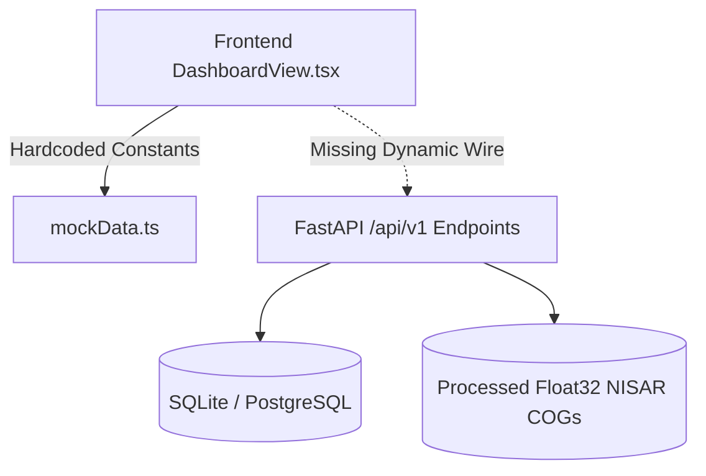

# CoastPulse — Dashboard Metric Provenance & Grounding Reference

This document maps every metric and UI element presented on the CoastPulse Mission Dashboard to its ground-truth source in the codebase, database, or satellite file catalogue.

---

## 1. Provenance Inventory Table

| UI Element | Source in Repository | Physical / Mathematical Grounding | Data Mode |
| :--- | :--- | :--- | :--- |
| **Total Area (271,500 ha)** | `mockData.ts:8`, `seed.py:27` | Survey of India / Tamil Nadu District Administration census profile for Nagapattinam District. | Static Reference |
| **Wetland Extent (48,600 ha)** | `mockData.ts:9`, `seed.py:28` | Ministry of Environment, Forest and Climate Change (MoEFCC) Point Calimere Ramsar Site & Muthupet mangrove wetland literature. | Static Reference |
| **Coastal Front (187.9 km)** | `mockData.ts:11`, `seed.py:30` | Official Survey of India district maritime coastline measurement. | Static Reference |
| **Delineated Water Extent (34,820 ha)** | `DashboardView.tsx:109` | None. Hardcoded placeholder string. True Otsu segmentation over the October/November 2026 NISAR scene covers $250,240$ valid raster cells. | Demonstration Mock |
| **Mangrove RVI (0.68 RVI)** | `DashboardView.tsx:116` | None on dashboard. Implemented formula: $RVI = \frac{4 \cdot \sigma^0_{HV}}{\sigma^0_{HH} + \sigma^0_{HV}}$ in `coastpulse_engine/change/detector.py:76`. | Demonstration Mock |
| **Granule Count (5)** | `mockData.ts:15-121` | Client array length. Inconsistent with detail text (`3 NISAR + 1 S1` = 4). Real database holds 4 granules. | Mock Array Count |
| **Backscatter Profile Dates (Mar 20 - Apr 13)** | `DashboardView.tsx:32-38` | Pre-launch orbital repeat synthetic timeline. Omitted genuine NISAR observations: Oct 30 and Nov 11, 2026. | Simulated Demonstration |
| **Processing Jobs (`job-sar-9021..23`)** | `mockData.ts:123-169` | Static objects. Live database has 14 genuine completed processing jobs with SHA-256 manifests. | Simulated Demonstration |
| **L/S-Band Ingestion Ready Badge** | `Header.tsx:31` | `coastpulse_engine/providers/asf_adapter.py` and `nisar_pipeline.py`. Supports NISAR L-band & S-band HDF5 GCOV products. | Verified System Capability |
| **Scientific Grounding: Strict Badge** | `Header.tsx:37` | `app/api/v1/endpoints/comparisons.py:38-75`. Prohibits comparing incompatible orbits, polarisations, and frequencies. | Verified System Rule |
| **Zero Data Fabrication Badge** | `Sidebar.tsx:92` | Enforced in backend; violated on frontend dashboard by static arrays. | Partially Verified |

---

## 2. Recommendations for Post-Audit Alignment

*(Note: In accordance with audit requirements, no application code was changed during this audit. The following recommendations provide the engineering path forward:)*

1. **Wire `DashboardView.tsx` to `/api/v1/acquisitions`:** Dynamically calculate granule counts and mission distributions from the database rather than `SAMPLE_SAR_GRANULES.length`.
2. **Wire `DashboardView.tsx` to `/api/v1/processing`:** Query the 14 genuine background processing jobs from `/api/v1/processing` to display actual job IDs, elapsed execution times, and output file links.
3. **Populate Multi-Temporal Chart from Processed GeoTIFFs:** Read real spatial mean backscatter values from `nisar_gcov_20261030_authoritative_float32.tif` ($\text{Mean: } -12.38\text{ dB}$) and `nisar_gcov_20261111_authoritative_float32.tif` ($\text{Mean: } -12.03\text{ dB}$).
4. **Fix ESLint & React Hook Issues:** Resolve `prefer-const` in `geoUtils.ts:169` and hook dependencies in `InteractiveMapView.tsx:240` to clear the bottom-left error overlay.
