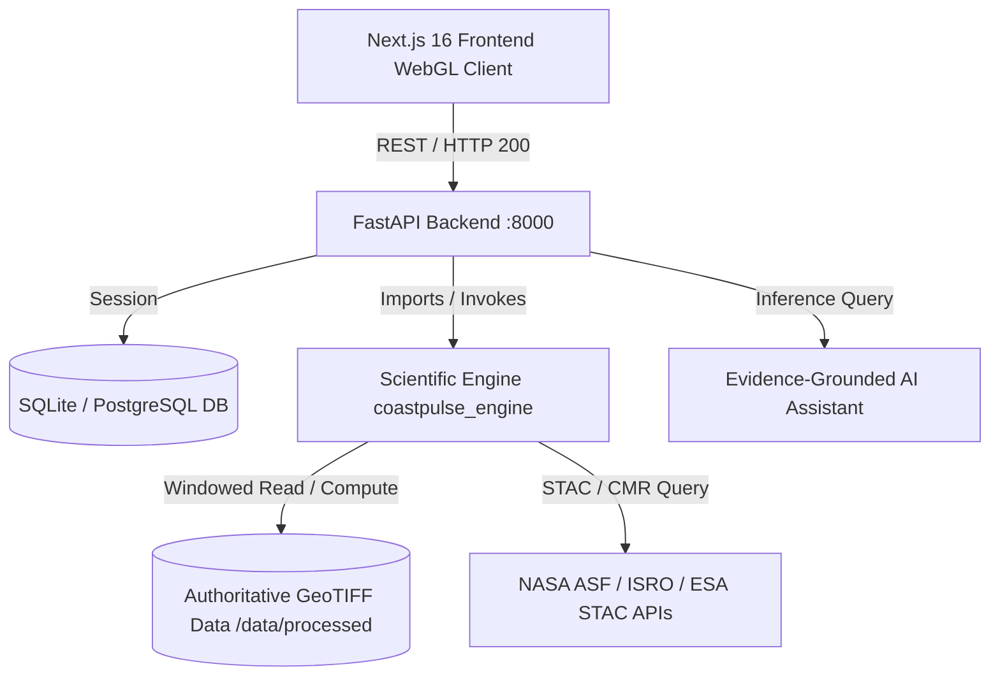

# Architecture

## 1. System Overview

CoastPulse is a modular geospatial analytics and Earth-observation platform engineered to process, calibrate, visualize, and analyze multi-temporal SAR (NISAR, Sentinel-1) and optical satellite data for coastal resilience.

The system is organized as a local-first monorepo comprising a Next.js 16 frontend workspace, a FastAPI backend service, a standalone scientific computation engine (`coastpulse_engine`), and an authoritative geospatial data warehouse.

## 2. Architecture Pattern

- **Pattern**: Modular Monorepo with Decoupled Geospatial Processing Micro-Kernels.
- **Reasoning**: Ensures rapid, low-latency communication between MapLibre WebGL frontend tiles and local Rasterio/GDAL windowed reading routines, eliminating cloud egress latencies during local field inspections.

## 3. Technology Stack

- **Frontend**: Next.js 16 (App Router, Turbopack), React 19, TypeScript, Tailwind CSS, MapLibre GL 4.x, Lucide React, Zustand.
- **Backend API**: Python 3.12+, FastAPI, Uvicorn, SQLAlchemy ORM, Alembic migrations, Pydantic v2.
- **Scientific Engine**: NumPy, SciPy, Rasterio, GDAL, Shapely, PyProj, ReportLab (PDF reporting).
- **Database**: SQLite (Development / Local Airgap), PostgreSQL + PostGIS (Production target).
- **Authentication**: JWT token-based auth with argon2 / passlib hashing.
- **Storage**: Local filesystem GeoTIFF cache with spatial indexing; optional AWS S3 / MinIO backend.

## 4. System Components



### Frontend (`coastpulse/frontend`)
- **Responsibilities**:
  - WebGL map canvas management via MapLibre GL.
  - Multi-tier layer management (Layer Library, Active Layers, Dynamic Styling, Zonal Statistics).
  - Client-side coordinate projections and geodesic measurements.
  - Local state persistence (`localStorage` for custom styling, pinned drawers, active filters).

### Backend (`coastpulse/backend`)
- **Responsibilities**:
  - RESTful API endpoints under `/api/v1/` for datasets, acquisitions, comparisons, event watch, and statistics.
  - Windowed raster sampling and histogram computation via `rasterio.windows.from_bounds`.
  - Database schema management and migration execution via Alembic.
  - Authentication, workspace management, and user study persistence.

### Scientific Engine (`coastpulse/scientific-engine`)
- **Responsibilities**:
  - Radiometric calibration ($\gamma^0, \sigma^0$) from digital numbers and complex antenna patterns.
  - Dual-polarization bi-temporal change detection and thresholding ($> 3\text{ dB}$).
  - Water extent extraction, Freeman-Durden polarimetric decomposition, and mangrove indices.
  - Automated PDF report compilation with cryptographic verification hashes.

## 5. Data Flow

1. User interacts with layer styling slider or selects AOI on the frontend map.
2. Frontend dispatches `GET /api/v1/geospatial/statistics?layer_id=...&min_lon=...` with viewport bounding box.
3. FastAPI endpoint parses coordinates and invokes `rasterio.open()` on authoritative GeoTIFF.
4. Windowed pixel subset is read directly into a Float32 NumPy masked array (nodata `-9999.0` excluded).
5. Statistical metrics (min, max, mean, median, std dev, 10-bin histogram) are computed in < 80 ms.
6. JSON response returns to frontend; SVG/KaTeX histogram and HUD probe render immediately.

## 6. Project Structure

```
coastpulse/
├── backend/                  # FastAPI Application
│   ├── app/
│   │   ├── api/v1/endpoints/ # API routes (datasets, comparisons, geospatial, stats)
│   │   ├── core/             # Configuration & security settings
│   │   ├── db/               # Database session & seed scripts
│   │   ├── models/           # SQLAlchemy database entities
│   │   ├── schemas/          # Pydantic v2 request/response schemas
│   │   └── services/         # Background pollers, job queues, AI advisor
│   └── tests/                # Pytest backend test suite
├── frontend/                 # Next.js 16 Web Application
│   ├── src/
│   │   ├── app/              # Next.js App Router (layout.tsx, page.tsx)
│   │   ├── components/       # UI Components (layout, modules, layers)
│   │   ├── lib/              # Client API service, layer store, geo utilities
│   │   └── types/            # TypeScript interface definitions
├── scientific-engine/        # Python Scientific Package (coastpulse_engine)
│   ├── coastpulse_engine/
│   │   ├── calibration/      # Radiometric & NISAR readers
│   │   ├── change/           # Bi-temporal change detection algorithms
│   │   ├── discovery/        # Multi-provider STAC/CMR satellite adapters
│   │   ├── reports/          # ReportLab PDF generator
│   │   └── uncertainty/      # Error metrics & validation
└── data/                     # Authoritative GeoTIFFs, KML footprints, and catalogs
```

## 7. Key Technical Decisions

- **Decision**: Float32 GeoTIFFs with Windowed Rasterio over Full Array Ingestion.
  - *Context*: Multi-temporal SAR scenes exceed hundreds of megabytes per band.
  - *Alternatives*: Reading entire GeoTIFF into server memory.
  - *Reason*: Windowed reading (`from_bounds`) consumes negligible memory (< 15 MB) and completes in sub-100 ms.
- **Decision**: Next.js Production Build (`next start`) for Local Server Execution.
  - *Context*: Turbopack JIT recompilation on Windows NTFS drives introduces disk latency on first visit.
  - *Reason*: Pre-compiled static/standalone build delivers instantaneous sub-300 ms response times.

## 8. Failure Scenarios & Mitigations

- **GeoTIFF Missing or Corrupted**: Backend returns HTTP 404 with explicit layer provenance error; frontend marks layer as `degraded` and prompts user to re-index granule.
- **STAC Catalogue Timeout**: Satellite discovery pollers utilize exponential backoff and circuit-breaker patterns to prevent thread starvation.
- **WebGL Context Loss**: Frontend listens to `webglcontextlost` events on the MapLibre canvas and automatically triggers canvas recreation without full page reload.
